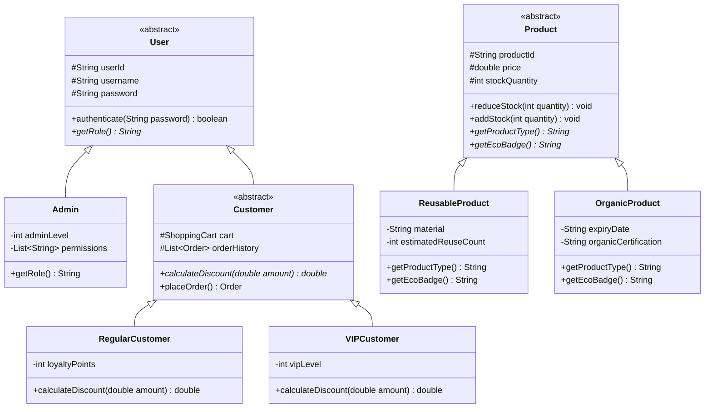

# 🛒 EcoShop — Hệ Thống Quản Lý Bán Hàng & Mua Sắm Trực Tuyến Sinh Thái

> **Học phần:** Lập Trình Hướng Đối Tượng (OOP) — Học kỳ 1, Năm học 2026-2027  
> **Giảng viên hướng dẫn:** ThS. Huỳnh Xuân Phụng  
> **Khoa:** Công Nghệ Thông Tin  
> **Công nghệ:** Java SE 11+, Kiến trúc hướng đối tượng thuần túy, Lưu trữ JSON không dùng thư viện ngoài.

---

## 👥 Danh Sách Thành Viên & Phân Hệ Đảm Nhiệm

| Thành viên (Họ & Tên) | GitHub Username | Phân hệ đảm nhiệm xuyên suốt đề tài |
| :--- | :--- | :--- |
| **Trương Triều Mến** *(Thành viên 1)* | [`truongtrieumen01-a11y`](https://github.com/truongtrieumen01-a11y) (`neMuierT`) | **Phân hệ Người dùng (`User`), Sản phẩm (`Product`), Quản trị viên (`Admin`) & Quản lý lưu trữ JSON (`JsonDataManager`)** |
| **Lê Lợi Khang** *(Thành viên 2)* | [`Kainn7`](https://github.com/Kainn7) (`Kainn77`) | **Phân hệ Giỏ hàng (`ShoppingCart`), Đơn hàng (`Order`), Thanh toán (`PaymentProcessor`), Ngoại lệ (`exception/`) & Khách hàng** |

---

## 📑 Báo Cáo Tiến Độ Các Tuần

Hệ thống được phát triển theo từng giai đoạn tuần tự, có báo cáo và minh chứng đầy đủ:

- 📘 [**Báo Cáo Tuần 1: Khởi Tạo Dự Án & Thiết Kế Khung Kiến Trúc Skeleton**](Tuan1/README.md)  
  *Khảo sát đề tài, thiết kế khung lớp, phân tích JSON vs CSV, sơ đồ lớp UML và định vị bất biến.*
- 📗 [**Báo Cáo Tuần 2: Hiện Thực Thân Hàm, Đa Hình Chiết Khấu & Đọc/Ghi JSON**](Tuan2/README.md)  
  *Tách cây kế thừa sản phẩm xanh (`ReusableProduct` & `OrganicProduct`), đa hình `calculateDiscount()`, nghiệp vụ Admin.*
- 📙 [**Báo Cáo Tuần 3: Xây Dựng EcoShopApp Điều Phối, Quản Lý Dữ Liệu JSON & Menu Admin**](Tuan3/README.md)  
  *Hợp nhất nhánh về `src/`, cặp hàm nạp/lưu `initData()` & `saveAllData()`, xác thực `User.authenticate()`, menu Admin và log chạy thử thật.*

---

## 🚀 Hướng Dẫn Biên Dịch & Chạy Ứng Dụng (1-Click Run)

Ứng dụng được viết bằng Java SE thuần (không yêu cầu cài đặt Maven hay Gradle).

### Cách 1: Chạy nhanh bằng script tự động
- **Trên Windows:** Bấm đúp vào tệp [`run.bat`](run.bat) hoặc mở terminal gõ:
  ```cmd
  run.bat
  ```
- **Trên Linux / macOS:** Mở terminal gõ:
  ```bash
  chmod +x run.sh
  ./run.sh
  ```

### Cách 2: Biên dịch thủ công bằng lệnh `javac`
```bash
# 1. Biên dịch toàn bộ mã nguồn
javac -encoding UTF-8 -d out src/exception/*.java src/model/*.java src/service/*.java src/app/*.java

# 2. Khởi chạy ứng dụng với mã hóa UTF-8
java -Dfile.encoding=UTF-8 -cp out app.EcoShopApp
```

---

## 🔑 Tài Khoản Kiểm Thử Có Sẵn Trong Hệ Thống

| Vai trò | Tên đăng nhập | Mật khẩu | Đặc điểm nổi bật |
| :--- | :--- | :--- | :--- |
| **Quản trị viên (Super Admin)** | `admin` | `admin123` | Toàn quyền xem kho, thêm/sửa/xóa sản phẩm, nhập hàng `addStock`, duyệt trạng thái đơn hàng và thống kê doanh thu. |
| **Khách hàng Thường (Regular)** | `alice` | `pass123` | Tích lũy điểm thưởng khi mua sắm, tự động nhận chiết khấu theo mức điểm tích lũy. |
| **Khách hàng VIP (VIP)** | `bob` | `pass123` | Khách VIP Vàng (Level 2), tự động nhận chiết khấu cố định 15% cho mọi hóa đơn. |

---

## 🛡️ 4 Trụ Cột Lập Trình Hướng Đối Tượng (OOP) Trong Đề Tài



1. **Đóng gói (Encapsulation):** Toàn bộ thuộc tính nghiệp vụ (`price`, `stockQuantity`, `password`, `cart`) đều ở phạm vi `private`/`protected`. Mọi thao tác xuất/nhập kho bắt buộc phải đi qua [`reduceStock(quantity)`](file:///d:/EcoShop/src/model/Product.java#L149-L160) và [`addStock(quantity)`](file:///d:/EcoShop/src/model/Product.java#L167-L171) để bảo vệ bất biến, ngăn ngừa tồn kho âm.
2. **Kế thừa (Inheritance):** Tách cây phân cấp Người dùng (`User` $\rightarrow$ `Admin`, `Customer` $\rightarrow$ `RegularCustomer`, `VIPCustomer`) và Sản phẩm xanh (`Product` $\rightarrow$ `ReusableProduct`, `OrganicProduct`), tái sử dụng tối đa mã nguồn chung.
3. **Đa hình (Polymorphism):**
   - Đa hình chiết khấu: Gọi `customer.calculateDiscount(amount)` tự động áp dụng công thức theo điểm tích lũy hoặc cấp bậc VIP mà không cần dùng `if-else / instanceof`.
   - Đa hình hiển thị: Gọi `product.getEcoBadge()` tự sinh huy hiệu sinh thái tương ứng cho từng dòng sản phẩm.
   - Đa hình lưu trữ: Giao diện `JsonSerializable` cho phép mỗi đối tượng tự sinh chuỗi JSON qua phương thức `toJson()`.
4. **Trừu tượng (Abstraction):** `User`, `Customer`, `Product` là các `abstract class`; `Discountable`, `JsonSerializable` là các interface định nghĩa hợp đồng nghiệp vụ rõ ràng, che giấu chi tiết cài đặt bên trong.

---

## 📁 Cấu Trúc Thư Mục Dự Án Chuẩn Mực

```text
EcoShop/
├── .gitignore                          <-- Cấu hình bỏ qua tệp build và runtime JSON
├── readme.md                           <-- Trang chủ dự án (Tệp này)
├── run.bat                             <-- Kịch bản biên dịch & chạy trên Windows
├── run.sh                              <-- Kịch bản biên dịch & chạy trên Linux/macOS
│
├── data_samples/                       <-- Dữ liệu mẫu JSON chuẩn được theo dõi trong Git
│   ├── users.json                      <-- Tài khoản mẫu (Admin, Regular, VIP)
│   ├── products.json                   <-- Danh mục sản phẩm xanh mẫu
│   └── orders.json                     <-- Lịch sử đơn hàng mẫu
│
├── docs/                               <-- Tài liệu phân tích chuyên sâu
│   ├── ARCHITECTURE.md                 <-- Kiến trúc phân tầng của hệ thống
│   ├── OOP_ANALYSIS.md                 <-- Phân tích chi tiết 4 tính chất OOP
│   ├── DATABASE_SCHEMA.md              <-- Sơ đồ cấu trúc JSON & bảng bất biến
│   ├── USER_GUIDE.md                   <-- Hướng dẫn thao tác cho người dùng
│   └── diagrams/                       <-- Sơ đồ kiến trúc & PlantUML
│       └── ecoshop_class_diagram.puml  <-- Sơ đồ lớp UML tổng thể
│
├── Tuan1/                              <-- Tài liệu & skeleton Tuần 1
│   ├── README.md                       <-- Báo cáo Tuần 1
│   └── skeleton/                       <-- Khung mã nguồn khởi tạo
│
├── Tuan2/                              <-- Tài liệu & kết quả Tuần 2
│   └── README.md                       <-- Báo cáo Tuần 2
│
├── Tuan3/                              <-- Tài liệu & kết quả Tuần 3
│   └── README.md                       <-- Báo cáo Tuần 3 (kèm log chạy thử thật)
│
└── src/                                <-- Mã nguồn hoàn chỉnh của ứng dụng
    ├── app/                            <-- Tầng điều khiển chính
    │   └── EcoShopApp.java             <-- Controller trung tâm hệ thống
    ├── exception/                      <-- Tầng xử lý ngoại lệ tùy chỉnh
    │   ├── EcoShopException.java       <-- Ngoại lệ cơ sở (Base Exception)
    │   ├── InsufficientStockException.java
    │   ├── InvalidInputException.java
    │   ├── PaymentFailedException.java
    │   └── ProductNotFoundException.java
    ├── model/                          <-- Tầng thực thể nghiệp vụ (OOP Domain Model)
    │   ├── Discountable.java
    │   ├── JsonSerializable.java
    │   ├── User.java & Admin.java
    │   ├── Customer.java, RegularCustomer.java, VIPCustomer.java
    │   ├── Product.java, ReusableProduct.java, OrganicProduct.java
    │   ├── CartItem.java & ShoppingCart.java
    │   ├── Order.java & OrderStatus.java
    └── service/                        <-- Tầng dịch vụ lưu trữ & thanh toán
        ├── JsonDataManager.java        <-- Quản lý tệp JSON (initData, saveAllData)
        └── PaymentProcessor.java       <-- Xử lý thanh toán đa kênh
```
