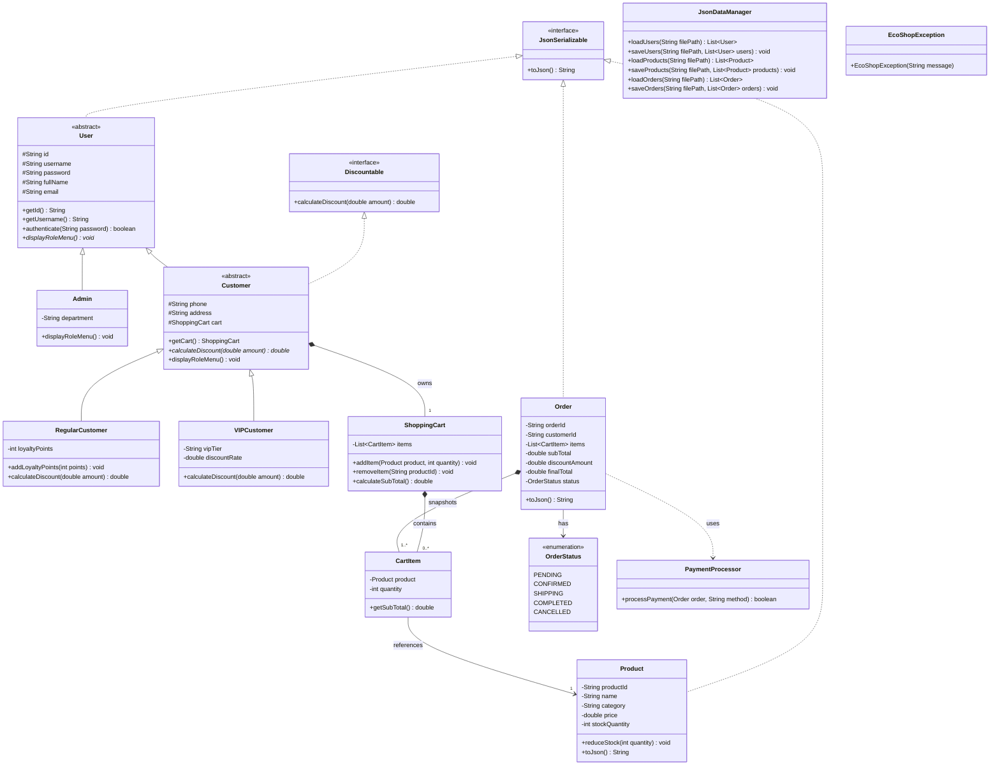

# Tuần 1: Khởi Tạo Dự Án & Thiết Kế Khung Kiến Trúc
## 1. Mục Tiêu Trọng Tâm & Chức Năng Cốt Lõi Tuần 1

1. **Khảo sát & Phân tích Đề tài:**
   - Xây dựng hệ thống mua sắm sản phẩm xanh **EcoShop** trên giao diện Console với phân cấp người dùng (`User` $\rightarrow$ `Admin`, `Customer` $\rightarrow$ `RegularCustomer`, `VIPCustomer`).
   - Áp dụng cơ chế tính chiết khấu đa hình (`calculateDiscount()`), lưu trữ dữ liệu bền vững bằng tệp JSON (`data_samples/`) và bắt lỗi ngoại lệ không làm chương trình bị dừng đột ngột (crash).
2. **Phân quyền Chức năng Chính:**
   - **Khách hàng (`RegularCustomer` & `VIPCustomer`):** Đăng ký/Đăng nhập; duyệt và tìm kiếm sản phẩm; quản lý giỏ hàng (`ShoppingCart`, `CartItem`); đặt hàng và thanh toán (`Order`, `PaymentProcessor`) với mức chiết khấu tự động theo hạng thẻ/điểm tích lũy.
   - **Quản trị viên (`Admin`):** Quản lý danh mục kho sản phẩm (`Thêm` / `Sửa` / `Xóa` / cập nhật tồn kho `Product`); kiểm duyệt trạng thái đơn hàng (`OrderStatus`) và thống kê doanh thu.

## 2. Ánh Xạ 4 Tính Chất OOP & Error Handling (Chuẩn `Tuan1/skeleton`)

| Tính chất / Kỹ thuật | Lớp / Giao diện áp dụng trong `skeleton/` | Mô tả thiết kế trong Tuần 1 |
| :--- | :--- | :--- |
| **1. Inheritance (Kế thừa)** | `User` $\rightarrow$ `Admin`, `Customer` $\rightarrow$ `RegularCustomer`, `VIPCustomer`; `EcoShopException` $\rightarrow$ 4 lớp ngoại lệ con | Tái sử dụng thuộc tính định danh người dùng ở lớp cha `User` và mở rộng thuộc tính riêng (điểm tích lũy cho `RegularCustomer`, cấp bậc VIP cho `VIPCustomer`). |
| **2. Polymorphism (Đa hình)** | `RegularCustomer.calculateDiscount()`, `VIPCustomer.calculateDiscount()` | Cùng thực thi phương thức `calculateDiscount()` từ `Customer`/`Discountable` nhưng tính tỷ lệ giảm giá khác nhau tùy theo đối tượng thực tế lúc chạy chương trình. |
| **3. Abstraction (Trừu tượng)** | Abstract class `User`, `Customer`; Interface `Discountable`, `JsonSerializable` | Ẩn chi tiết tính toán khuyến mãi và tuần tự hóa JSON đằng sau giao diện chung; tách biệt xử lý lưu trữ tại `JsonDataManager` và thanh toán tại `PaymentProcessor`. |
| **4. Encapsulation (Đóng gói)** | Tất cả các lớp trong gói `model/` (`User`, `Product`, `ShoppingCart`, `Order`...) | Khai báo thuộc tính ở phạm vi `private` hoặc `protected`; kiểm soát truy cập và ràng buộc dữ liệu thông qua hệ thống Getter/Setter. |
| **5. Error Handling (Xử lý lỗi)** | Gói `exception/` (`EcoShopException`, `InvalidInputException`, `InsufficientStockException`, `PaymentFailedException`, `ProductNotFoundException`) | Xây dựng cây ngoại lệ tùy chỉnh kết hợp khối `try-catch` tại `EcoShopApp` và `JsonDataManager` để chống crash khi nhập sai kiểu dữ liệu hoặc thiếu tồn kho. |

## 3. Sơ Đồ Lớp UML (Đồng Bộ Theo `Tuan1/skeleton`)



## 4. Cấu Trúc Thư Mục & Tệp Dữ Liệu Mẫu (`data_samples/`)

```text
Tuan1/
├── README.md                          <-- Tài liệu tổng quan Tuần 1 (Tệp này)
├── PHAN_TICH_DU_LIEU_JSON_CSV.md      <-- Khảo sát & Đánh giá so sánh cấu trúc JSON vs CSV
├── KE_HOACH_TUAN_1.md                 <-- Kế hoạch công việc & Tiêu chí nghiệm thu
│
├── data_samples/                      <-- Dữ liệu mẫu JSON chuẩn phục vụ kiểm thử & thiết kế parser
│   ├── users.json                     <-- Mẫu người dùng đa hình (Admin, RegularCustomer, VIPCustomer)
│   ├── products.json                  <-- Mẫu danh mục kho sản phẩm xanh
│   └── orders.json                    <-- Mẫu đơn hàng lồng ghép (Nested Order & Items)
│
└── skeleton/                          <-- Khung mã nguồn tổng quan chuẩn OOP (Chưa code thân hàm)
    ├── app/
    │   └── EcoShopApp.java            <-- Skeleton ứng dụng điều khiển Console chính
    ├── exception/
    │   ├── EcoShopException.java      <-- Lớp ngoại lệ cơ sở (Base Exception)
    │   ├── InsufficientStockException.java
    │   ├── InvalidInputException.java
    │   ├── PaymentFailedException.java
    │   └── ProductNotFoundException.java
    ├── model/
    │   ├── Discountable.java          <-- Giao diện tính chiết khấu
    │   ├── JsonSerializable.java      <-- Giao diện tuần tự hóa JSON
    │   ├── User.java                  <-- Lớp trừu tượng Người dùng
    │   ├── Admin.java                 <-- Skeleton Quản trị viên
    │   ├── Customer.java              <-- Lớp trừu tượng Khách hàng
    │   ├── RegularCustomer.java       <-- Skeleton Khách hàng thường (Điểm tích lũy)
    │   ├── VIPCustomer.java           <-- Skeleton Khách hàng VIP (Cấp bậc)
    │   ├── Product.java               <-- Skeleton Sản phẩm
    │   ├── CartItem.java              <-- Skeleton Mục giỏ hàng
    │   ├── ShoppingCart.java          <-- Skeleton Giỏ hàng
    │   ├── Order.java                 <-- Skeleton Đơn hàng
    │   └── OrderStatus.java           <-- Enum Trạng thái đơn hàng
    └── service/
        ├── JsonDataManager.java       <-- Skeleton xử lý lưu trữ tệp JSON thuần Java SE
        └── PaymentProcessor.java      <-- Skeleton xử lý thanh toán đa phương thức
```


## 5. Đánh Giá Hạn Chế & Những Điều Chưa Kịp Thực Hiện Ở Tuần 1
Hạn chế: 

    Nhánh kế thừa Sản phẩm (`Product`)** | Lớp `Product.java` trong `skeleton/model/` hiện mới dừng ở một lớp đơn lẻ (concrete class), chưa tách thành cây kế thừa (`ReusableProduct` - tái sử dụng & `OrganicProduct` - hữu cơ có hạn sử dụng). | Cân nhắc chuyển `Product` thành `abstract class` và bổ sung 2 lớp con ở Tuần 2 để thể hiện tính Đa hình rõ nét hơn ở cả nhánh `User` và `Product`. |
    Đọc/Ghi JSON thuần Java SE (`JsonDataManager`)** | Tự viết bộ phân tích chuỗi (parser) JSON thuần Java SE không dùng thư viện ngoài (`Gson`/`Jackson`) dễ phát sinh lỗi khi chuỗi tên sản phẩm chứa dấu ngoặc kép hoặc khi đọc mảng lồng nhau (`Order` chứa `List<CartItem>`). | Chuẩn hóa quy tắc định dạng chuỗi JSON trong `JsonSerializable.toJson()` hoặc tích hợp thư viện `Gson` nếu giảng viên cho phép. |
    Xử lý Đa hình Thanh toán (`PaymentProcessor`)** | `PaymentProcessor.java` hiện đang gộp chung các phương thức thanh toán vào một lớp dịch vụ thay vì tách thành các lớp thực thi giao diện riêng biệt (`CODPayment`, `EWalletPayment`). | Áp dụng Strategy Pattern cho nhánh thanh toán để mở rộng phương thức mới mà không cần sửa đổi code cũ. |
    Dữ liệu mẫu & Bảo mật (`data_samples/`)** | Mật khẩu trong `users.json` đang lưu dạng văn bản thuần (plain text); dữ liệu mẫu mới chỉ bao phủ trường hợp hợp lệ (happy path), thiếu các bản ghi kiểm thử lỗi biên. | Bổ sung các bản ghi sản phẩm tồn kho bằng `0`, giá trị biên và chuỗi lỗi định dạng để kiểm thử toàn bộ 5 lớp trong gói `exception/`. |

Những điều chưa kịp thực hiện:

    Chưa viết thân hàm thực thi (Method Body) cho các lớp trong `app/`, `model/`, `service/` và `exception/` hiện mới hoàn thiện khai báo thuộc tính, constructor, và ghi chú `// TODO`, chưa có logic xử lý thực tế.
    Chưa hiện thực công thức tính chiết khấu đa hình (`calculateDiscount`): Hai lớp `RegularCustomer` và `VIPCustomer` mới có khung phương thức ghi đè.
    Chưa hoàn thiện thuật toán đọc/ghi file trong `JsonDataManager.java`: Chưa viết xong code đọc dữ liệu từ các file .json lên các danh sách `List<User>`, `List<Product>`, `List<Order>`.
    Chưa ghép nối luồng nghiệp vụ Đặt hàng & Trừ tồn kho (`ShoppingCart` $\rightarrow$ `Order): Chưa thực hiện luồng chuyển danh sách `CartItem` từ giỏ hàng sang hóa đơn `Order`, kiểm tra `InsufficientStockException`, trừ `stockQuantity` của `Product` và lưu cập nhật xuống tệp JSON.
